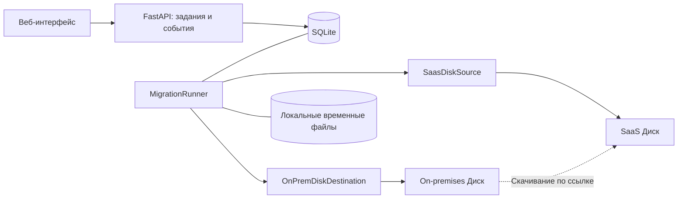

# Перенос файлов из SaaS Яндекс Диска в on-premises

Дата: 11 октября 2026 года.
Статус: спецификация для обсуждения перед реализацией.
Проект: `yandex-disk-copy`.

## 1. Задача и согласованные решения

Добавить в существующую веб-утилиту направление SaaS → Яндекс 360 on-premises.
Результат переноса — проверенные копии файлов и структура каталогов в Диске
получателя. Завершение HTTP-запроса само по себе не означает завершения переноса.

Согласовано с пользователем:

- Основной способ: **«Напрямую по ссылке»**. On-premises скачивает файл по
  временной ссылке, полученной утилитой с правами владельца SaaS Диска.
- Выбираемая опция: **«С временным сохранением»**. Утилита сохраняет отдельный
  файл на сервере переноса, затем потоково загружает его в on-premises.
- Автоматическое переключение между способами не входит в первый этап.
- Пользователь собирает on-premises стенд; проектирование и подготовку сценариев
  проверки выполняет агент. Проверки реальной интеграции выполняются на стенде.

Рабочее предположение для пилота: один источник SaaS → один личный Диск
on-premises, с пользовательским токеном получателя. Пакетный перенос и общие
диски проектируются как следующие этапы; массовый административный доступ к
личным Дискам требует подтверждения поддерживаемого механизма авторизации.

## 2. Границы первого этапа

В первый этап входят:

- Предварительная проверка доступа, соответствия получателя и путей.
- Инвентаризация выбранного дерева, включая пустые каталоги.
- Оба согласованных способа передачи.
- Постоянный журнал заданий, файлов, попыток и безопасных событий.
- Проверка размера и контрольной суммы, конфликты без перезаписи.
- Восстановление после перезапуска, ручной повтор установленных ошибок.
- Пауза между файлами, история заданий и итоговый отчёт.

Для пилота используются активные пользователи источника. Автоматическая
временная разблокировка источника требует отдельного механизма восстановления
доступа, описанного в разделе 12, и подключается последующим этапом.

В этот этап не входят удаление источника, перенос ACL, публичных ссылок, истории
версий и гарантия сохранения серверных дат создания/изменения. Согласованные
правила действующих SaaS → SaaS и локального сохранения сохраняются.

## 3. Проверенные факты и ограничения доказательств

Документация прочитана в браузере 11 октября 2026 года; на проверенных страницах
сайта отображалась версия `v3.0.17`. Это версия опубликованной справки, а не
подтверждение версии будущего стенда.

| Факт | Источник |
|---|---|
| On-premises использует собственные API/OAuth-хосты; загрузчик и хранилище находятся на отдельных хостах | [Доступ к API](https://help.solution.korobka360.ru/disk/api/concepts/quickstart.html) |
| Quickstart описывает получение пользовательского OAuth-токена через паспорт инсталляции и client ID администратора | [Доступ к API](https://help.solution.korobka360.ru/disk/api/concepts/quickstart.html) |
| `POST /v1/disk/resources/upload` с `url` и `path` запускает скачивание; успешный запуск возвращает `202` и ссылку на статус; сервер сам не повторяет ошибочное скачивание | [Загрузка по URL](https://help.solution.korobka360.ru/disk/api/reference/upload-ext.html) |
| Для POST по URL параметр `overwrite` не описан; ошибка `409` описана | [Загрузка по URL](https://help.solution.korobka360.ru/disk/api/reference/upload-ext.html) |
| `GET /v1/disk/resources/upload` поддерживает `overwrite=false`; возвращает адрес PUT и `operation_id` | [Загрузка файла](https://help.solution.korobka360.ru/disk/api/reference/upload.html) |
| Адрес загрузчика нужно запросить в течение 30 минут после получения; PUT на него не требует OAuth; ответы включают `201` и `202` | [Загрузка файла](https://help.solution.korobka360.ru/disk/api/reference/upload.html) |
| Метаинформация файла включает `size` и `md5`; данные Диска включают `total_space` и `used_space` | [Метаданные](https://help.solution.korobka360.ru/disk/api/reference/meta.html), [Объём](https://help.solution.korobka360.ru/disk/api/reference/capacity.html) |
| `POST /v1/disk/resources/move` поддерживает `overwrite=false`; файл или пустая папка возвращают `201`; для долгой операции описан `202` и polling | [Перемещение](https://help.solution.korobka360.ru/disk/api/reference/move.html) |
| Операция имеет состояния `in-progress`, `success`, `failed` | [Статус операции](https://help.solution.korobka360.ru/disk/api/reference/operations.html) |

Не подтверждены стендом: применимость owner-download ссылки SaaS к server-pull
on-premises, административный token-exchange/impersonation, безопасная семантика
финального move при гонке и падении, восстановление потерянного идентификатора
операции, протокол дозагрузки по байтам, доступность хешей на фактической версии.
Поддержка `Content-Range` упомянута в ошибках PUT, но полного протокола
восстановления недостаточно для обещания такой функции.

## 4. Размещение и компоненты

Развёртывание: существующее приложение FastAPI и один управляемый worker в
одном процессе, рядом с инфраструктурой заказчика. Worker запускается и
останавливается через lifespan FastAPI; задания не привязываются к HTTP-сессии.
SQLite и локальные временные файлы находятся на постоянном томе.

Обязанности:

| Компонент | Обязанность |
|---|---|
| `SaasDiskSource` | Token-exchange, листинг, stat, ссылка владельца, потоковое скачивание |
| `OnPremDiskDestination` | Авторизация назначения, папки, stat, импорт URL, PUT, polling, move |
| `UrlTransfer` | Запуск скачивания on-premises и наблюдение за результатом |
| `StagedTransfer` | Потоковое скачивание на сервер переноса и потоковая загрузка |
| `MigrationRunner` | План, проверки, переходы состояний, повтор, восстановление |
| `MigrationStore` | Транзакции SQLite, очередь, журнал попыток и событий |
| `CredentialRegistry` | Учётные данные только в памяти, привязанные к заданию |

Worker выполняет одну файловую передачу за раз в пилоте. Очередь допускает
несколько заданий, но лимит активной работы общий. Межпроцессная блокировка
тома разрешает только одного worker; второй экземпляр отказывается начинать
работу. Масштабирование Uvicorn и общий том между контейнерами не поддерживаются
в этом этапе. SQLite не размещается на сетевой файловой системе.

## 5. Авторизация и адреса назначения

Источник использует сервисное приложение SaaS и token-exchange по email.
Назначение использует отдельный OAuth-токен пользователя on-premises.
Наличие административного токена API 360 не считается доказательством доступа
к личному Диску другого пользователя.

Конфигурация назначения содержит API base URL и ожидаемую личность получателя.
Сертификат корпоративного CA монтируется администратором в контейнер; TLS
проверяется. API-хост, passport, uploader и downloader не вычисляются заменой
суффикса SaaS-домена. Используются адреса инсталляции и проверенные ссылки API.

Проверка личности получателя выполняется документированным endpoint конкретной
инсталляции, подтверждённым стендом. Если API не возвращает пригодный identity,
пилот использует явно подтверждённую администратором привязку тестового токена к
одноразовому пользователю; массовый режим до автоматической проверки блокируется.

Токены и client secret передаются отдельно от постоянной конфигурации и не
пишутся в SQLite, события, CSV, localStorage и отчёт. После перезапуска задания
требуют повторного предоставления доступов. При reattach сверяются исходные
org/client/user и URL/получатель назначения; перенос продолжает использовать
тот же план и те же идентификаторы попыток.

Ссылки скачивания и загрузки являются данными доступа: они существуют только
в памяти, передаются нужному сервису и исключаются из обычных логов. На
загрузчик не отправляется OAuth-заголовок API. Ссылки API-операций разбираются
структурированно: сохраняется ID и безопасный относительный адрес операции,
без неизвестных параметров доступа. Неизвестный формат ссылки требует проверки
адаптера и не исполняется автоматически.

## 6. План, пути и предварительная проверка

Перед передачей строится план файлов и каталогов. Для каждого файла фиксируются
источник, исходный путь, размер, modified, доступный hash и итоговый путь.
План не считается консистентным снимком активного Диска.

`destination_root` задаётся явно. Предложение для начального значения —
`disk:/<email источника>`, как в действующей утилите; пользователь может выбрать
другую папку, включая корень. План показывает точные результирующие пути до
запуска. Для `source_path=/` сохраняется всё дерево; для выбранного каталога
сохраняется и сам каталог, а для одного файла — его имя.

Проверки плана: Unicode и URL-кодирование, ограничение длины имени/пути,
коллизии после нормализации, тип файла/каталога, количество файлов и байтов,
необходимое место, доступность хешей. Неподдерживаемые пути становятся
явными ошибками плана; тихого переименования нет.

Если информация о квоте доступна, учитывается место назначения и технических
файлов. Недоступная информация о квоте даёт результат «оценка недоступна»,
а не нулевой объём. API-ошибки доступа не трактуются как пустой Диск.

Для server-pull доступ к SaaS требуется от самого сервиса on-premises.
Успешный curl с ноутбука или доступность ссылки из контейнера утилиты этого
не подтверждают. Проверка маленьким файлом на стенде проводится как отдельный
интеграционный сценарий; обычный preflight остаётся читающим.

## 7. Технический каталог назначения и завершение файла

Оба режима передают файл в собственный технический каталог on-premises, например:

`disk:/.disk-copy-transfer-<job-id>/<entry-id>/<attempt-id>/<исходное имя файла>`

Технический каталог on-premises не является локальным временным сохранением:
в режиме по ссылке байты не проходят через диск сервера утилиты. Он находится
в личном Диске получателя, учитывается в квоте и может быть виден пользователю.

Корень выбирается при создании задания и сохраняется в журнале. План проверяет,
что ни один результирующий пользовательский путь не попадает в техническое
поддерево и не является его конфликтующим предком. Уже существующий или
конфликтующий технический путь не переиспользуется; выбирается новая собственная
namespace. Исходное имя сохраняется внутри каталога attempt, в том числе для
корректной обработки расширения. Проверка итогового дерева сравнивает пути
плана; собственная namespace учитывается отдельно как служебный остаток.

Порядок:

1. Сохранить intent и уникальный путь попытки в SQLite до внешней мутации.
2. Передать файл выбранным способом и получить установленный результат.
3. Проверить технический файл по размеру и hash, сверить fingerprint источника.
4. Сохранить intent финализации.
5. Выполнить move в итоговый путь с явным `overwrite=false`.
6. При необходимости дождаться операции; проверить итоговые размер и hash.
7. Транзакционно записать успех; после этого освободить собственный локальный файл.

Безопасная финализация — обязательная проверка стенда. Документированный
`overwrite=false` не является отдельным обещанием атомарного move. Если стенд
не подтверждает защиту итоговых файлов при гонке, обычные пользовательские
папки не допускаются к пилотному выпуску; одной проверки «пути ещё нет» мало.
Возможное дополнительное место при move также измеряется на стенде.

Существующий итоговый файл не перезаписывается. Перед пропуском сверяется текущий
fingerprint источника с планом; изменение даёт `source_changed`, даже если
назначение совпадает со старой версией. При актуальном источнике совпадение размера
и hash назначения классифицируется как `already_verified`, несовпадение — `conflict`. Ответ
`409` сам по себе успехом не считается. Конфликт файла с каталогом остаётся
конфликтом. Папки создаются от родителей к детям; `409` допустим только после
подтверждения типа существующего ресурса.

## 8. Две стратегии передачи

### 8.1. Напрямую по ссылке (`url`)

Получить свежую ссылку владельца SaaS непосредственно перед отправкой, без
publish. Передать её в `POST resources/upload` на технический путь назначения.
Сохранить operation ref сразу после ответа и опрашивать его с растущим
интервалом. `success` переводит файл к проверке; `failed` — к установленной
ошибке; `in-progress` сохраняет ожидание.

Срок ожидания утилиты ограничивает один сеанс наблюдения, но не определяет
завершение серверной операции. Долгая операция остаётся ожидающей, а не получает
ошибку только из-за прежнего SaaS-порога 600 секунд. Память и локальный диск не
расходуются пропорционально размеру файла. Отображается прогресс по файлам и
проверенным байтам; процент скачивания внутри on-premises не выдумывается.

### 8.2. С временным сохранением (`staged`)

Каталог внутри контейнера: `/var/lib/disk-copy/staging`, на постоянном томе.
Локальное имя содержит ID задания/файла и случайный ID объекта; оно не строится
как `<пользовательское имя>.part` в каталоге downloads.

Файл скачивается блоками; по пути считаются размер и MD5, при необходимости
SHA-256. После завершения проверяются исходный hash и fingerprint. Только
проверенный локальный объект допускается к загрузке. Каждый повтор отправки
открывает файл заново. Ссылка загрузчика запрашивается после готовности файла,
а не перед многогигабайтным скачиванием.

Настраиваются бюджет staging, резерв свободного места и количество активных
передач. Файл, который не помещается, получает понятную ошибку до скачивания,
если размер известен; при неизвестном размере бюджет проверяется по мере
записи. Корректно обрабатывается изменение свободного места другим процессом.

После подтверждённого результата в БД собственный локальный объект удаляется.
После установленной ошибки загрузки проверенный объект сохраняется для повтора
до ручной очистки задания. Бюджет занятого места продолжает его учитывать.
Незавершённое скачивание в пилоте начинается сначала; проверенный полный файл
можно использовать после повторной сверки fingerprint и локального hash.

## 9. Постоянные данные и состояния

SQLite: транзакции, foreign keys, WAL, схема с версией миграции. Пути и ошибки
содержат только необходимые рабочие данные. Записи состояний и соответствующие
события коммитятся одной транзакцией. SQLite и staging защищаются правами тома.

| Сущность | Основные поля |
|---|---|
| `job` | ID, даты, state, стратегия, source org/client/user/root, destination URL/identity/root, credential binding, технический корень |
| `entry` | ID, job ID, kind, source path/ID если доступен, size/modified/hash, relative path, destination path, state, verification level, current attempt |
| `attempt` | ID, entry ID, стратегия, фаза, technical path, intent/request state, operation ref, local staging ID, safe error, время и счётчик попыток |
| `event` | job ID, возрастающий sequence, время, тип, entry ID, безопасная нагрузка |

Токены, заголовки и signed URL в эти сущности не входят. Idempotency key
приложения при создании задания обеспечивает одну запись job при повторе
HTTP-запроса; он не приписывает idempotency стороннему API.

Путь файла через состояния:

`planned → transferring → waiting_operation → verifying → committing → done`

У staged внутри передачи есть `downloading` и `staged`. Дополнительные результаты:
`already_verified`, `conflict`, `source_changed`, `failed`, `outcome_unknown`.
Состояние `done` допускается после проверки назначения; каталоги имеют отдельные
счётчики. Отсутствие server hash не заменяется совпадением размеров: файл получает
`verification_unavailable` и требует решения оператора, не обычный `done`.

Состояния задания: `queued`, `planning`, `ready`, `running`, `paused`,
`awaiting_credentials`, `needs_attention`, `completed`, `completed_with_issues`.
`completed` означает, что все объекты выполнены или уже проверены; конфликт,
смена источника и ошибка отражаются в `completed_with_issues`. Неопределённая
активная операция переводит задание в `needs_attention`.

## 10. Повторы, перезапуск и неопределённый результат

Внешний запрос и SQLite-транзакция не образуют одну атомарную операцию.
Нельзя обещать exactly-once передачу. Защита строится на журнале intent,
уникальном пути попытки, проверке результата и финальном запрете перезаписи.

| Ситуация | Действие |
|---|---|
| Запрос ещё не отправлен | Можно отправить сохранённую попытку |
| Ответ и operation ref сохранены | Продолжить polling после проверки доступов |
| Запрос мог уйти, ответ/ref потерян | `outcome_unknown`; без автоматического повтора |
| Polling временно недоступен | Повторять чтение; не повторять импорт |
| Операция подтвердила `failed` | Установленная ошибка, доступен ручной повтор |
| Move мог выполниться, подтверждение потеряно | Сверить ref, технический и итоговый пути; не повторять move вслепую |
| Источник изменён | `source_changed`; новый план по явному действию |

До отправки intent записывается устойчиво. Сбой между этой записью и реальной
отправкой консервативно допускает `outcome_unknown`: это цена защиты от дублей.
Если op ref потерян, `404` технического файла не доказывает, что import завершился
ошибкой. Наличие файла с правильным hash также не доказывает завершение неизвестной
server-pull операции. Для такого случая требуется установление результата по
подтверждённому контракту стенда либо проверка администратора; истечение таймера
не считается доказательством. Терминальное решение оператора фиксируется событием.

Для финализации допустимые правила восстановления по наблюдаемым ресурсам
фиксируются только после проверки стендом. Одно наличие итогового пути не даёт
`done`. Условия должны включать совпадение содержимого и отсутствие операции,
которая ещё может изменить результат.

При перезапуске worker под блокировкой читает незавершённые состояния, сохраняет
их попытки и требует reattach credentials. Затем сначала выполняет reconciliation,
а не новый перенос. Повтор установленных ошибок создаёт новый attempt и новый
technical path, с явно выбранной стратегией. `conflict` и `outcome_unknown` не
входят в действие «Повторить неудачные».

Новые мутации не используют универсальный retry того же PreparedRequest.
Повторы чтения имеют backoff, jitter и Retry-After. Для POST import/move и PUT
тела решение о повторе принимает runner после проверки исхода; повторная
отправка из исчерпанного handle исключена.

Лимиты источника общие с действующими режимами SaaS в том же процессе.
Создание независимого второго SaaS-бюджета запрещено. Назначение имеет отдельный
бюджет, настроенный по фактической инсталляции. Одновременно ограничиваются
активные передачи, polling и локальное место. Фиксированные SaaS 40/5 не
объявляются лимитами on-premises.

## 11. Пауза, очистка и изменение источника

Запрос паузы прекращает запуск новых файлов. Текущий файл при известных
операциях и доступных credentials завершается, проверяется и финализируется;
после него job становится `paused`. Polling уже принятых операций не зависит
от признака pause_requested. Неопределённый исход и потеря доступа имеют
приоритет: job становится `needs_attention` или `awaiting_credentials`.
Принятая server-pull операция не объявляется отменённой: подтверждённого API
отмены пока нет. Пользователь видит pending operations.

Автоматическая очистка первого этапа касается только собственных терминальных
локальных объектов staging. После restart она удаляет собственные остатки
`done`/`already_verified`, если процесс упал между коммитом результата и unlink.
Работающие, неопределённые и неизвестные объекты не удаляются по TTL; очистка
выполняется под guard worker и проверяет принадлежность объекта журналу.

Удалённая очистка в пилоте выполняется администратором в интерфейсе Диска по
отчёту служебных остатков после установления завершения операций. Утилита не
выполняет рекурсивное удаление технических каталогов: предварительное чтение
содержимого не защищает от гонки с добавлением чужого файла. После успешного
move остаются пустые каталоги; неудачные/неопределённые попытки могут занимать
квоту и явно перечисляются. Автоматическая удалённая очистка требует отдельного
подтверждённого контракта условного удаления. Исходные файлы не удаляются.

Административное действие «Установить результат попытки» привязано к job/attempt
и текущей revision. Предпочтительный ввод — operation ID, найденный в журнале
on-premises с подтверждённым соответствием этой попытке; адаптер проверяет его
статус. Если ID восстановить нельзя, оператор фиксирует терминальный исход и
описание проверенных серверных доказательств прекращения работы. Один таймер,
`404` или наличие файла не являются допустимым доказательством. Действие и
безопасное обоснование сохраняются в журнале; устаревшая revision отклоняется.
Результат `failed` разрешает новую попытку. Результат `success` переводит к
проверке размера/hash и актуальности источника, а не напрямую в `done`.
Действие доступно только администратору защищённой инсталляции утилиты; при
отсутствии серверных доказательств попытка остаётся `outcome_unknown`.

Перед передачей и после неё сверяются исходные размер, modified и hash. При
изменении источника техническая копия не финализируется как исходная версия
плана. Для полного перехода пользователей требуется согласованное окно остановки
изменений и новый финальный план; бесконечная фоновая синхронизация не входит в
задачу. Оригинальные source даты сохраняются в отчёте, даже если API назначения
не позволяет установить их как серверные даты.

## 12. Поддержка временно заблокированных источников

Этот этап использует отдельный журнал восстановления доступа. До изменения
пользователя записываются org/user, исходный статус, intent, необходимость
восстановления и безопасное подтверждение изменения. На пользователя берётся
общая блокировка с действующими режимами, чтобы два задания не меняли статус
независимо друг от друга.

Восстановление выполняется после терминальных операций и при остановке работы.
После аварии оно приоритетнее продолжения миграции. Без admin credentials
приложение показывает `source_access_recovery_required` и действие повторного
предоставления доступа; не обещает, что `finally` сработает при падении процесса.
При неопределённой удалённой операции оператору явно сообщается, что восстановление
блокировки может повлиять на ещё идущую загрузку. Изначально активного пользователя
не выключают. Пилот с активными источниками не выполняет эти мутации.

## 13. API и интерфейс

Новый router `/api/onprem` изолирует устойчивые задания от действующего `JOBS`.

| Endpoint | Поведение |
|---|---|
| `POST /api/onprem/preflight` | Читающая проверка source/destination, identity, доступных capabilities |
| `POST /api/onprem/jobs` | Создать сохраняемый job; стратегия по умолчанию `url`; idempotency key |
| `GET /api/onprem/jobs` | История заданий с пагинацией |
| `GET /api/onprem/jobs/{id}` | Конфигурация без секретов, состояния, счётчики, необходимое действие |
| `GET /api/onprem/jobs/{id}/entries` | Файлы/каталоги, фильтр по состоянию, пагинация |
| `POST /api/onprem/jobs/{id}/start` | Запуск проверенного плана после просмотра итоговых путей |
| `PUT /api/onprem/jobs/{id}/credentials` | Временный reattach credentials с проверкой binding |
| `POST /api/onprem/jobs/{id}/resume` | Reconciliation незавершённых попыток, затем продолжение |
| `POST /api/onprem/jobs/{id}/retry` | Новый attempt только для установленных ошибок, выбранная стратегия |
| `POST /api/onprem/jobs/{id}/pause` | Пауза между файлами с сохранением активных удалённых операций |
| `POST /api/onprem/jobs/{id}/resolve` | Административное установление терминального исхода попытки с ref/доказательствами и revision |
| `POST /api/onprem/jobs/{id}/cleanup` | Очистка собственных терминальных локальных объектов; удалённые остатки только в отчёт |
| `GET /api/onprem/jobs/{id}/events` | SSE из постоянного журнала с sequence/Last-Event-ID |
| `GET /api/onprem/jobs/{id}/report` | CSV: пути, выбранный способ, результат, проверка и безопасная ошибка |

Новый режим «SaaS → On-premises» получает собственный флаг доступности, который
не зависит от `CROSS_ORG_ENABLED`. Решение о включении в обе линии образов
принимается при выпуске; пилот не меняет назначение существующих тегов.

Форма: source credentials/email/path, on-prem API URL/OAuth/expected recipient,
папка назначения и поле «Способ переноса» с двумя согласованными вариантами.
Далее экран плана: точные пути, файлы/байты, конфликты и ограничения проверки.
Экран задания показывает статусы, историю безопасных событий и отдельные
результаты «Перенесено», «Уже совпадает», «Конфликт», «Ошибка», «Нужна проверка».
Ручной повтор позволяет выбрать «С временным сохранением» для установленных
ошибок импорта по ссылке. Для `outcome_unknown` предусмотрено административное
действие установления результата с доказательствами; очистка показывает объекты
локального staging и отчёт удалённых остатков. Состояние формы не хранит секреты
в браузере. При сетевом доступе используется защищённая административная сессия
утилиты; обычный публичный доступ к управлению заданиями не допускается.

Управление заданием не передаёт в UI подписанные ссылки и raw exceptions.
Разрыв SSE допускает replay по sequence и обновление статуса обычным GET.

## 14. Изменения в репозитории

Новый пакет `app/migration/`: `models`, `source`, `destination`, `strategies`,
`store`, `worker`, `api`; отдельный `app/static/onprem.js` для нового режима.
Число файлов можно уточнить по фактическому размеру реализации; универсальный
фреймворк провайдеров и распределённая очередь не требуются.

В `main.py` добавляются router/lifespan и безопасная конфигурация. В Compose —
постоянный приватный том для SQLite/staging и настройка CA; в Docker — права
каталогов и запуск одного процесса. Пользовательская справка дополняется после
проверки реальной интеграции. Локальная DNS-правка compose сохраняется.

Переиспользуются проверенные части token-exchange, пагинации, owner download,
Retry-After и path mapping. Источник нового режима не вызывает `DiskCopier.run()`
и не публикует файлы. Известные дефекты fixed `.part`, сохранения signed URL в
исключениях и повтора потокового тела не переносятся в новый пакет.

Кодовая база для проектирования: `app/disk_copy.py` (token-exchange около 188,
листинг 404, owner download 703, memory fallback 747, local stream 889),
`app/main.py` (in-memory JOBS 166, SSE около 622), `app/throttle.py`.
Это адреса ориентиров на состоянии 11 октября, а не контракт будущих строк.

## 15. Этапы и критерии приёмки

1. **Подтверждение контрактов стенда.** OAuth и identity, source URL server-pull,
   polling, MD5, конфликты и финальный move без перезаписи. Результаты записываются
   отдельно от предположений справки.
2. **Одиночная миграция.** Оба способа, plan, SQLite, технические пути, проверка,
   восстановление, UI и отчёт. Сначала активный source и личный destination.
3. **Массовый режим.** Поддерживаемая авторизация нескольких получателей, mapping
   пользователей, пакет до 25 записей и контролируемая параллельность до 5.
   Общие бюджеты сохраняются при нескольких заданиях. Общие диски требуют
   отдельного подтверждения adapter/capabilities.
4. **Эксплуатационные расширения.** Восстановление блокировки источника, уточнённая
   очистка и, при необходимости, подтверждённая дозагрузка по байтам.

Перед приёмкой одиночного режима должны пройти сценарии из соседнего документа
`2026-10-11-saas-to-onprem-test-stand.md`, включая потерю ответа POST, restart
во время polling/move, конфликт и большой файл в каждом способе.

Критерии: ни один существующий итоговый файл не перезаписан; нет ложного успеха;
данные проверены по размеру/hash; состояние после restart объяснимо и сохраняется;
байты по URL не пишутся на сервер переноса; staging ограничен; signed URL и
credentials отсутствуют в UI/SQLite/отчёте; прежние тесты SaaS проходят.

## 16. Решения, которые уточняются по стенду

| Вопрос | Как влияет на проект | Кто/как подтверждает |
|---|---|---|
| Фактическая версия, OAuth и identity | Способ авторизации и проверки получателя | Администратор стенда и проба API |
| Server-pull owner URL SaaS | Работоспособность основного способа | Реальный файл с проверкой hash |
| Move с overwrite=false при гонке | Допуск к пользовательским итоговым папкам | Тест конфликтов и сетевых прерываний |
| Потерянный operation ref | Правила `outcome_unknown` и возможности reconciliation | Ответы API/логи администратора |
| Хеши и ограничения файла/пути | Гарантия проверки и preflight | Метаданные и крупные тестовые файлы |
| Массовый доступ к личным Дискам | Переход от пилота к пакетной миграции | Документированный механизм поставщика |

Эти вопросы не препятствуют проектированию. Они являются проверяемыми условиями
реализации и выпуска соответствующей возможности, а не обещанием её поддержки.
